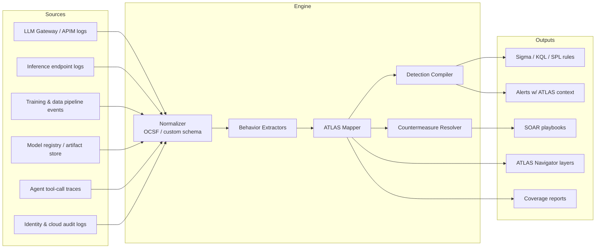

# ATLAS Behavior Map

**Behavior-to-MITRE ATLAS mapping engine for detecting and countering adversarial activity against AI/ML systems.**

[](LICENSE)
[](https://atlas.mitre.org)
[]()

---

## Overview

ATLAS Behavior Map converts raw telemetry from AI workloads (LLM gateways, inference endpoints, training pipelines, model registries, agent tool calls) into **observable behaviors**, maps each behavior to **MITRE ATLAS tactics and techniques**, and binds each technique to **detection logic** and **countermeasures** (ATLAS mitigations, plus automated response actions).

```
Telemetry ──► Behavior ──► ATLAS Technique ──► Detection ──► Countermeasure ──► Response
```

### Goals

- **Single source of truth** for AI threat behaviors, versioned as code.
- **Bidirectional traceability**: behavior ⇄ technique ⇄ detection ⇄ mitigation.
- **Coverage measurement** against the full ATLAS matrix (gaps, partial, full).
- **SIEM/SOAR portability**: emit Sigma, KQL (Microsoft Sentinel), SPL (Splunk), and ATT&CK Navigator layers from one definition.
- **ATT&CK bridging**: link ATLAS techniques to related ATT&CK enterprise techniques where the attack chain crosses into conventional infrastructure.

### Non-Goals

- Not a replacement for ATLAS. Technique and mitigation data is pulled from the official [`mitre-atlas/atlas-data`](https://github.com/mitre-atlas/atlas-data) release and pinned by version.
- Not a model firewall. It drives guardrails and controls; it does not implement them.

---

## Architecture



| Component | Responsibility |
|---|---|
| **Normalizer** | Maps source events into a common schema (OCSF-aligned, with AI-specific extensions: `prompt`, `completion`, `model_id`, `tool_call`, `token_usage`). |
| **Behavior Extractors** | Stateless and windowed detectors that emit behavior events (e.g., `BHV-PI-001: instruction override pattern in user input`). |
| **ATLAS Mapper** | Resolves behaviors to ATLAS tactic/technique/sub-technique IDs with a confidence score. |
| **Detection Compiler** | Compiles behavior definitions to target query languages. |
| **Countermeasure Resolver** | Binds ATLAS mitigations (`AML.M*`) and executable response actions to each technique. |

The diagram describes the integration architecture. The current CLI evaluates **already-normalized
JSONL events** using signatures, field matches, and windowed thresholds, then generates rules,
coverage reports, and response plans. Source adapters and the normalizer are not included yet.
Production enforcement is performed by your connected controls or SOAR playbooks; local response
execution defaults to a dry run.

---

## Data Model

Each behavior is a YAML file under `behaviors/`. The mapping is the contract; everything else is generated.

```yaml
id: BHV-EXF-003
name: High-volume systematic inference queries consistent with model extraction
status: stable            # experimental | test | stable | deprecated
severity: high
confidence: medium

description: >
  A single principal issues a large number of structurally similar queries
  against an inference endpoint with low semantic variance and systematic
  input perturbation, consistent with surrogate-model training.

atlas:
  tactics:
    - AML.TA0010          # Exfiltration
  techniques:
    - id: AML.T0024.002   # Extract AI Model (via inference API)
      relationship: primary
    - id: AML.T0040       # AI Model Inference API Access
      relationship: precondition

attack_bridge:            # optional ATT&CK enterprise linkage
  - T1567                 # Exfiltration Over Web Service

telemetry:
  required:
    - source: inference_gateway
      fields: [timestamp, principal_id, model_id, session_id, input_embedding_norm]
  optional:
    - source: identity
      fields: [auth_method, ip, asn]

detection:
  logic: windowed_threshold
  window: 1h
  group_by: [principal_id, model_id]
  filters:
    principal_id: { not_in: [sp-batch-eval, sp-loadtest] }
  metrics:
    request_count: count
    input_embedding_variance: variance(input_embedding_norm)
    distinct_session_count: dcount(session_id)
  conditions:
    - request_count > 5000
    - input_embedding_variance < 0.15
    - distinct_session_count <= 2
  false_positives:
    - Authorized batch evaluation jobs (allowlist by service principal)
    - Load testing in non-prod

countermeasures:
  mitigations:
    - AML.M0004           # Restrict Number of AI Model Queries
    - AML.M0002           # Passive AI Output Obfuscation
    - AML.M0019           # Control Access to AI Models and Data in Production
  response:
    - action: rate_limit
      params: { principal: "{{principal_id}}", limit: 100/min, ttl: 24h }
    - action: degrade_output
      params: { mode: top1_label_only }
    - action: open_incident
      params: { queue: ai-sec, priority: P2 }
    - action: revoke_token            # requires_approval by registry default
      params: { principal: "{{principal_id}}" }

tests:
  - fixture: tests/fixtures/extraction_burst.jsonl
    expect: alert
  - fixture: tests/fixtures/benign_batch_eval.jsonl
    expect: no_alert

references:
  - https://atlas.mitre.org/techniques/AML.T0024
```

---

## Coverage Snapshot (115 behaviors)

| Behavior ID | Behavior | ATLAS Technique | Primary Mitigations | Default Response |
|---|---|---|---|---|
| BHV-PI-001 | Instruction-override pattern in direct user input | AML.T0051.000 LLM Prompt Injection: Direct | AML.M0020, AML.M0015 | Block, log, increment principal risk |
| BHV-PI-002 | Embedded instructions in retrieved content (RAG / web / email) | AML.T0051.001 LLM Prompt Injection: Indirect | AML.M0020, AML.M0015 | Quarantine source doc, strip, alert |
| BHV-JB-001 | Role-play / persona jailbreak sequences | AML.T0054 LLM Jailbreak | AML.M0020, AML.M0021 | Refuse, session risk escalation |
| BHV-LK-001 | System prompt disclosure in completion (canary + phrasing) | AML.T0056 Extract LLM System Prompt | AML.M0020 | Redact output, risk, incident |
| BHV-LK-002 | Sensitive data / PII in completion | AML.T0057 LLM Data Leakage | AML.M0020, AML.M0019 | DLP redact, incident |
| BHV-EXF-001 | Membership-inference probing (repeated candidates + scores) | AML.T0024.000 Infer Training Data Membership | AML.M0002, AML.M0004 | Label-only output, rate limit |
| BHV-EXF-002 | Model-inversion probing (single class + scores + perturbation) | AML.T0024.001 Invert AI Model | AML.M0002, AML.M0004 | Label-only output, rate limit |
| BHV-EXF-003 | Systematic extraction query volume | AML.T0024.002 Extract AI Model | AML.M0004, AML.M0002, AML.M0019 | Rate limit, degrade output, revoke |
| BHV-EV-001 | Adversarial perturbation in classifier inputs | AML.T0015 Evade AI Model / AML.T0043 Craft Adversarial Data | AML.M0015, AML.M0003 | Reject input, flag for review |
| BHV-PO-001 | Training data distribution shift (PSI) at ingest | AML.T0020 Poison Training Data | AML.M0007, AML.M0014 | Halt pipeline, incident |
| BHV-SC-001 | Unsigned / hash-mismatched model artifact loaded | AML.T0010.003 AI Supply Chain Compromise: Model | AML.M0014, AML.M0016 | Block deploy, alert |
| BHV-BD-001 | Backdoor trigger response in model scan (high ASR) | AML.T0018.000 Poison AI Model / AML.T0043.004 Insert Backdoor Trigger | AML.M0014, AML.M0008 | Block deploy, pull model, incident |
| BHV-AG-001 | Agent tool call outside declared scope | AML.T0053 AI Agent Tool Invocation | AML.M0019, AML.M0020 | Deny call, kill session |
| BHV-DOS-001 | Token-exhaustion / sponge inputs | AML.T0029 Denial of AI Service | AML.M0004 | Throttle, cap max tokens |
| BHV-CH-001 | Abnormal compute spend per principal | AML.T0034 Cost Harvesting | AML.M0004, AML.M0019 | Quota enforce, alert finance + SOC |
| BHV-AG-002 | Agent runs download-and-execute or encoded shell command | AML.T0050 Command and Scripting Interpreter | AML.M0029, AML.M0032, AML.M0026 | Deny tool call, kill session, open incident |
| BHV-AG-003 | Reverse shell from agent sandbox | AML.T0072 Reverse Shell | AML.M0032, AML.M0029 | Deny tool call, kill session, open incident |
| BHV-AG-004 | Sandbox escape attempt from agent | AML.T0105 Escape to Host | AML.M0032, AML.M0026 | Deny tool call, kill session, open incident |
| BHV-AG-005 | Agent reads credential files | AML.T0098 AI Agent Tool Credential Harvesting | AML.M0026, AML.M0028 | Deny tool call, kill session, rotate credentials, open incident |
| BHV-AG-006 | Agent issues destructive data operations | AML.T0101 Data Destruction via AI Agent Tool Invocation | AML.M0029, AML.M0026 | Deny tool call, kill session, open incident |
| BHV-AG-007 | Runaway agent loop | AML.T0034.002 Cost Harvesting: Agentic Resource Consumption | AML.M0004, AML.M0029 | Kill session, notify |
| BHV-AG-008 | High-risk tool call after untrusted content without approval | AML.T0053 AI Agent Tool Invocation | AML.M0030, AML.M0029 | Deny tool call, notify |
| BHV-AG-009 | Agent acts with more privilege than the requesting user | AML.T0053 AI Agent Tool Invocation | AML.M0027, AML.M0026 | Deny tool call, open incident |
| BHV-AG-010 | Agent configuration changed by a non-admin | AML.T0081 Modify AI Agent Configuration | AML.M0026, AML.M0019 | Open incident, notify |
| BHV-AG-011 | Browsing agent clicks into a download, login form or OAuth consent on an untrusted page | AML.T0100 AI Agent Clickbait | AML.M0029, AML.M0030 | Deny tool call, notify |
| BHV-AG-012 | Agent enumerates cloud services | AML.T0075 Cloud Service Discovery | AML.M0026, AML.M0032 | Kill session, open incident |
| BHV-AG-013 | Agent performs process discovery | AML.T0089 Process Discovery | AML.M0032, AML.M0024 | Notify |
| BHV-AG-014 | Agent application token used from a new network location | AML.T0091.000 Use Alternate Authentication Material: Application Access Token | AML.M0026, AML.M0019 | Revoke token, open incident |
| BHV-AG-015 | AI agent deployed by an unapproved principal (shadow agent) | AML.T0103 Deploy AI Agent | AML.M0026, AML.M0024 | Notify, open incident |
| BHV-BD-002 | Trigger pattern in production input flips the prediction | AML.T0043.004 Craft Adversarial Data: Insert Backdoor Trigger | AML.M0015, AML.M0008 | Block request, open incident |
| BHV-BD-003 | Production weights changed without a training job | AML.T0018 Manipulate AI Model | AML.M0014, AML.M0005 | Pull model, open incident |
| BHV-BD-004 | Malware signature embedded in model file | AML.T0018.002 Manipulate AI Model: Embed Malware | AML.M0016, AML.M0014 | Quarantine artifact, block deploy, open incident |
| BHV-BD-005 | Backdoor anomaly index high at model validation | AML.T0018.000 Manipulate AI Model: Poison AI Model | AML.M0008, AML.M0014 | Block deploy, notify |
| BHV-BD-006 | Canary-set accuracy drop after model update | AML.T0031 Erode AI Model Integrity | AML.M0008, AML.M0014 | Pull model, notify |
| BHV-CH-002 | API key spending from several networks at once | AML.T0034.000 Cost Harvesting: Excessive Queries | AML.M0004, AML.M0019 | Revoke token, notify |
| BHV-CH-003 | API key fanned out to many client IPs (proxy resale) | AML.T0034.000 Cost Harvesting: Excessive Queries | AML.M0004, AML.M0019 | Revoke token, open incident |
| BHV-CH-004 | Sudden premium-model spend | AML.T0034.001 Cost Harvesting: Resource-Intensive Queries | AML.M0004 | Enforce quota, notify |
| BHV-CH-005 | Unapproved large GPU training job | AML.T0034.001 Cost Harvesting: Resource-Intensive Queries | AML.M0019 | Halt pipeline, notify |
| BHV-CH-006 | Free-tier account farm from one device | AML.T0021 Establish Accounts | AML.M0019, AML.M0004 | Step up auth, notify |
| BHV-CH-007 | Agent session spend exceeds budget | AML.T0034.002 Cost Harvesting: Agentic Resource Consumption | AML.M0004, AML.M0029 | Kill session, notify |
| BHV-DOS-002 | Request flood from one principal | AML.T0029 Denial of AI Service | AML.M0004 | Rate limit |
| BHV-DOS-003 | Unbounded repetition / output-expansion prompt | AML.T0029 Denial of AI Service | AML.M0004, AML.M0020 | Cap tokens, block request |
| BHV-DOS-004 | Repeated context-window saturation | AML.T0029 Denial of AI Service | AML.M0004 | Cap tokens, rate limit |
| BHV-DOS-005 | Inference timeouts concentrated on one principal | AML.T0029 Denial of AI Service | AML.M0004, AML.M0015 | Rate limit, notify |
| BHV-DOS-006 | Oversized top-k vector search | AML.T0029 Denial of AI Service | AML.M0004 | Block request, notify |
| BHV-DOS-007 | Decompression-bomb media input | AML.T0029 Denial of AI Service | AML.M0015, AML.M0004 | Block request, increment risk |
| BHV-DOS-008 | Reasoning-token exhaustion | AML.T0029 Denial of AI Service | AML.M0004 | Cap tokens, notify |
| BHV-EV-002 | Black-box adversarial search: near-duplicate inputs flipping predictions | AML.T0043.001 Craft Adversarial Data: Black-Box Optimization | AML.M0015, AML.M0004, AML.M0003 | Rate limit, degrade output, open incident |
| BHV-EV-003 | Malware-classifier evasion via many variants of one family | AML.T0015 Evade AI Model | AML.M0015, AML.M0006 | Increment risk, open incident |
| BHV-EV-004 | Adversarial patch detected in camera input | AML.T0015 Evade AI Model | AML.M0015, AML.M0009 | Block request, notify |
| BHV-EV-005 | Homoglyph / confusable characters slipping past moderation | AML.T0015 Evade AI Model | AML.M0010, AML.M0015 | Block request, increment risk |
| BHV-EV-006 | Chaff flooding of a detection model | AML.T0046 Spamming AI System with Chaff Data | AML.M0004, AML.M0015 | Rate limit, notify |
| BHV-EV-007 | Deepfake media submitted to identity verification | AML.T0015 Evade AI Model | AML.M0034, AML.M0009 | Block request, step up auth, open incident |
| BHV-EXF-004 | Agent sends data to a non-allowlisted external endpoint | AML.T0086 Exfiltration via AI Agent Tool Invocation | AML.M0028, AML.M0029 | Deny tool call, kill session, open incident |
| BHV-EXF-005 | Agent emails attachments to an external recipient on its own initiative | AML.T0086 Exfiltration via AI Agent Tool Invocation | AML.M0029, AML.M0030 | Deny tool call, open incident |
| BHV-EXF-006 | Bulk model-weight downloads by one principal | AML.T0025 Exfiltration via Cyber Means | AML.M0005, AML.M0001 | Revoke token, open incident |
| BHV-EXF-007 | Restricted training dataset downloaded outside its ACL | AML.T0035 AI Artifact Collection | AML.M0005, AML.M0025 | Revoke token, open incident |
| BHV-EXF-008 | Logprob harvesting across many unique prompts (distillation) | AML.T0024.002 Exfiltration via AI Inference API: Extract AI Model | AML.M0002, AML.M0004 | Degrade output, rate limit, open incident |
| BHV-EXF-009 | Daily output volume consistent with proxy-model replication | AML.T0005.001 Create Proxy AI Model: Train Proxy via Replication | AML.M0004, AML.M0019 | Rate limit, notify |
| BHV-EXF-010 | Hyperlink in completion carrying encoded data | AML.T0077 LLM Response Rendering | AML.M0020, AML.M0033 | Redact output, open incident |
| BHV-EXF-011 | Agent reads a secret and makes external egress in the same session | AML.T0086 Exfiltration via AI Agent Tool Invocation | AML.M0026, AML.M0029, AML.M0032 | Kill session, rotate credentials, open incident |
| BHV-EXF-012 | Embedding inversion probing with near-identical inputs | AML.T0024.001 Exfiltration via AI Inference API: Invert AI Model | AML.M0002, AML.M0004 | Rate limit, notify |
| BHV-EXF-013 | Vector store bulk export or full scan | AML.T0085.000 Data from AI Services: RAG Databases | AML.M0005, AML.M0019 | Revoke token, open incident |
| BHV-JB-002 | Many-shot jailbreak via long fabricated dialogue | AML.T0054 LLM Jailbreak | AML.M0020, AML.M0022 | Block request, increment risk |
| BHV-JB-003 | Crescendo: harm score escalating across a session | AML.T0054 LLM Jailbreak | AML.M0020, AML.M0022 | Kill session, open incident |
| BHV-JB-004 | Request to answer in an encoding or cipher to evade filters | AML.T0054 LLM Jailbreak | AML.M0020, AML.M0015 | Block request, increment risk |
| BHV-JB-005 | Refusal-suppression instructions | AML.T0054 LLM Jailbreak | AML.M0020, AML.M0022 | Block request, increment risk |
| BHV-JB-006 | Fiction or hypothetical framing for prohibited instructions | AML.T0054 LLM Jailbreak | AML.M0020, AML.M0022 | Block request, increment risk |
| BHV-JB-007 | Optimized adversarial suffix appended to prompt | AML.T0054 LLM Jailbreak | AML.M0015, AML.M0020 | Block request, increment risk |
| BHV-JB-008 | Jailbreak probing: repeated refusals in one session | AML.T0054 LLM Jailbreak | AML.M0020, AML.M0004 | Kill session, notify |
| BHV-JB-009 | Prompt matches known jailbreak corpus | AML.T0054 LLM Jailbreak | AML.M0020, AML.M0015 | Block request, increment risk, open incident |
| BHV-JB-010 | Authority impersonation or fake debug-mode unlock | AML.T0054 LLM Jailbreak | AML.M0020, AML.M0022 | Block request, increment risk |
| BHV-JB-011 | Jailbreak acknowledgement markers in completion | AML.T0054 LLM Jailbreak | AML.M0020, AML.M0022 | Redact output, kill session, open incident |
| BHV-LK-003 | System-prompt discovery questions | AML.T0069.002 Discover LLM System Information: System Prompt | AML.M0020, AML.M0021 | Increment risk |
| BHV-LK-004 | Special-token and delimiter probing | AML.T0069.000 Discover LLM System Information: Special Character Sets | AML.M0020, AML.M0015 | Increment risk |
| BHV-LK-005 | Credentials or tokens in model completion | AML.T0057 LLM Data Leakage | AML.M0020, AML.M0012 | Redact output, rotate credentials, open incident |
| BHV-LK-006 | Bulk email addresses in a single completion | AML.T0057 LLM Data Leakage | AML.M0020, AML.M0019 | Redact output, open incident, notify |
| BHV-LK-007 | Retrieved chunk belongs to another tenant | AML.T0057 LLM Data Leakage | AML.M0019, AML.M0005 | Strip content, quarantine vector records, open incident |
| BHV-LK-008 | RAG returns documents above the caller's clearance | AML.T0085.000 Data from AI Services: RAG Databases | AML.M0019, AML.M0005 | Strip content, open incident |
| BHV-LK-009 | RAG index enumeration by one principal | AML.T0085.000 Data from AI Services: RAG Databases | AML.M0004, AML.M0019 | Rate limit, open incident |
| BHV-LK-010 | Credential-harvesting queries against the RAG index | AML.T0082 RAG Credential Harvesting | AML.M0019, AML.M0012 | Block request, increment risk, open incident |
| BHV-LK-011 | Verbatim training-data regurgitation | AML.T0057 LLM Data Leakage | AML.M0020, AML.M0002 | Redact output, notify |
| BHV-LK-012 | Classifier ontology discovery via label sweeping | AML.T0013 Discover AI Model Ontology | AML.M0002, AML.M0004 | Degrade output, rate limit |
| BHV-LK-013 | Model family fingerprinting questions | AML.T0014 Discover AI Model Family | AML.M0000, AML.M0020 | Increment risk |
| BHV-LK-014 | Agent tool-definition disclosure request | AML.T0084.001 Discover AI Agent Configuration: Tool Definitions | AML.M0020, AML.M0028 | Increment risk |
| BHV-PI-003 | Encoded instruction payload with decode-and-follow request | AML.T0068 LLM Prompt Obfuscation | AML.M0020, AML.M0015 | Block request, increment risk |
| BHV-PI-004 | Chat-template role delimiters injected in user input | AML.T0051.000 LLM Prompt Injection: Direct | AML.M0020, AML.M0015 | Block request, increment risk |
| BHV-PI-005 | Invisible Unicode tag characters smuggled in prompt | AML.T0068 LLM Prompt Obfuscation | AML.M0015, AML.M0020 | Block request, open incident |
| BHV-PI-006 | Instructions addressed to the assistant inside processed email | AML.T0051.001 LLM Prompt Injection: Indirect | AML.M0020, AML.M0030 | Strip content, quarantine source, open incident |
| BHV-PI-007 | Hidden HTML text carrying instructions in retrieved page | AML.T0051.001 LLM Prompt Injection: Indirect | AML.M0020, AML.M0030 | Strip content, quarantine source |
| BHV-PI-008 | Delayed trigger instruction planted in retrieved content | AML.T0094 Delay Execution of LLM Instructions | AML.M0020, AML.M0030 | Strip content, quarantine source, open incident |
| BHV-PI-009 | Markdown image in completion leaking data via URL parameters | AML.T0077 LLM Response Rendering | AML.M0020, AML.M0033 | Redact output, open incident |
| BHV-PI-010 | Self-replicating prompt instructing copies into future outputs | AML.T0061 LLM Prompt Self-Replication | AML.M0020, AML.M0030 | Block request, increment risk, open incident |
| BHV-PI-011 | Injection submitted through a public-facing form, review or ticket | AML.T0093 Prompt Infiltration via Public-Facing Application | AML.M0020, AML.M0015 | Strip content, open incident |
| BHV-PI-012 | Repeated prompt-injection attempts by one principal | AML.T0051.000 LLM Prompt Injection: Direct | AML.M0020, AML.M0004 | Increment risk, step up auth, rate limit |
| BHV-PI-013 | Injected instructions in agent tool output | AML.T0051.001 LLM Prompt Injection: Indirect | AML.M0030, AML.M0033 | Deny tool call, kill session, open incident |
| BHV-PI-014 | Completion cites sources that were never retrieved | AML.T0067.000 LLM Trusted Output Components Manipulation: Citations | AML.M0020, AML.M0033 | Redact output, notify |
| BHV-PO-002 | Label disagreement spike in an ingested training batch | AML.T0020 Poison Training Data | AML.M0007, AML.M0025 | Halt pipeline, quarantine artifact |
| BHV-PO-003 | Single external contributor dominates training data intake | AML.T0020 Poison Training Data | AML.M0007, AML.M0025 | Quarantine artifact, notify |
| BHV-PO-004 | Instruction-bearing document upserted into RAG index from untrusted source | AML.T0070 RAG Poisoning | AML.M0025, AML.M0030 | Quarantine vector records, open incident |
| BHV-PO-005 | Near-duplicate document flood into the RAG index | AML.T0071 False RAG Entry Injection | AML.M0025, AML.M0004 | Quarantine vector records, notify |
| BHV-PO-006 | Persistent instruction written into agent long-term memory | AML.T0080.000 AI Agent Context Poisoning: Memory | AML.M0031, AML.M0030 | Purge agent memory, open incident |
| BHV-PO-007 | Chat history modified by someone other than the conversation owner | AML.T0092 Manipulate User LLM Chat History | AML.M0031, AML.M0019 | Open incident, notify |
| BHV-PO-008 | Fine-tuning a production model on unverified data | AML.T0020 Poison Training Data | AML.M0025, AML.M0007, AML.M0014 | Halt pipeline, notify |
| BHV-PO-009 | Curated dataset checksum mismatch at validation | AML.T0059 Erode Dataset Integrity | AML.M0025, AML.M0014 | Quarantine artifact, open incident |
| BHV-SC-002 | Model file with unsafe deserialization opcodes | AML.T0011.000 User Execution: Unsafe AI Artifacts | AML.M0016, AML.M0011 | Quarantine artifact, block deploy, open incident |
| BHV-SC-003 | Public-hub model from non-allowlisted publisher imported to prod | AML.T0010.003 AI Supply Chain Compromise: Model | AML.M0014, AML.M0023 | Block deploy, notify |
| BHV-SC-004 | Typosquatted ML package installed in a workspace | AML.T0011.001 User Execution: Malicious Package | AML.M0016, AML.M0011 | Open incident, notify |
| BHV-SC-005 | Unsigned container image deployed for inference | AML.T0010.004 AI Supply Chain Compromise: Container Registry | AML.M0013, AML.M0014 | Block deploy, notify |
| BHV-SC-006 | Agent tool manifest changed after approval (rug pull) | AML.T0109 AI Supply Chain Rug Pull | AML.M0028, AML.M0014 | Disable tool, open incident |
| BHV-SC-007 | Agent tool registered from an unverified publisher | AML.T0010.005 AI Supply Chain Compromise: AI Agent Tool | AML.M0028, AML.M0023 | Notify, open incident |
| BHV-SC-008 | Hidden instructions in an agent tool description (tool poisoning) | AML.T0110 AI Agent Tool Poisoning | AML.M0028, AML.M0033 | Disable tool, open incident |
| BHV-SC-009 | Model architecture differs from its signed manifest | AML.T0018.001 Manipulate AI Model: Modify AI Model Architecture | AML.M0014, AML.M0008 | Quarantine artifact, block deploy, open incident |
| BHV-SC-010 | External dataset imported without signed provenance | AML.T0010.002 AI Supply Chain Compromise: Data | AML.M0025, AML.M0023 | Quarantine artifact, notify |
| BHV-SC-011 | Recently created package installed on an LLM's suggestion (slopsquatting) | AML.T0011.001 User Execution: Malicious Package | AML.M0016, AML.M0018 | Open incident, notify |

> IDs and names are validated against ATLAS 5.6.0 (pinned in `atlas/atlas-data.lock`). If ATLAS renames or restructures a technique, `abm validate` fails and lists the drift.
>
> The first 15 (seed set) are listed first. The next 100 (behavior pack, IDs from -002/-003 upward) are generated from `scripts/behavior_pack/` by `scripts/gen_behavior_pack.py`. All ship at status `test` until their compiled queries are reviewed against real telemetry. Every behavior has a positive and a benign near-miss fixture.
>
> Seed set: Stable: PI-001, PI-002, JB-001, LK-001, LK-002, EXF-003, SC-001. Test: EXF-001, EXF-002, EV-001, PO-001, BD-001, AG-001, DOS-001. Experimental: CH-001.
>
> EV-001, PO-001 and BD-001 consume scores from upstream controls (adversarial-input detector, drift monitor, backdoor scanner); they map and act on those signals rather than compute them. LK-001 requires a system-prompt canary (`ABM-CANARY-<8 hex>`) injected at the gateway.

---

## Repository Structure

```
.
├── behaviors/                 # Behavior definitions (source of truth)
│   ├── prompt-injection/
│   ├── exfiltration/
│   ├── supply-chain/
│   ├── jailbreak/
│   ├── leakage/
│   ├── evasion/
│   ├── poisoning/
│   ├── backdoor/
│   ├── agentic/
│   ├── availability/
│   └── cost/
├── atlas/
│   ├── catalog.yaml           # ATLAS tactics/techniques/mitigations (from atlas-sync)
│   ├── atlas-data.lock        # Pinned ATLAS release + sha256
│   └── NOTICE
├── src/abm/
│   ├── models.py              # Behavior schema (pydantic)
│   ├── catalog.py             # ATLAS catalog + atlas-data import
│   ├── loader.py / validator.py
│   ├── engine.py              # Reference detection engine (replay, fixtures)
│   ├── response.py            # Action registry, response planner, executors
│   ├── coverage.py            # Scoring, gaps, Navigator layer
│   ├── compilers/             # kql.py, sigma.py, spl.py
│   └── cli.py                 # `abm` CLI
├── schemas/behavior.schema.json   # Generated from the model (make schema)
├── scripts/gen_fixtures.py    # Deterministic fixture generator
├── tests/
│   ├── fixtures/              # Positive + benign near-miss JSONL telemetry
│   └── test_*.py              # Engine, validation, compiler, integration and tutorial tests
├── examples/tutorial/        # Runnable walkthrough with a separate behavior set
├── integrations/xsoar/        # Cortex XSOAR setup and playbook guidance
├── docs/behavior-authoring.md
├── dist/                      # Generated rules (gitignored)
├── reports/                   # Generated coverage (gitignored)
├── .github/workflows/ci.yml
├── Makefile
└── pyproject.toml
```

---

## Quickstart

### Prerequisites

- Python 3.11+
- Optional: `make` for the convenience targets on Linux/macOS

Runtime dependencies are only `pydantic` and `PyYAML`.

### Install

```bash
git clone https://github.com/airios1111/atlasbehavior001.git
cd atlasbehavior001
python -m venv .venv
```

Activate the environment with `source .venv/bin/activate` on Linux/macOS or
`.\.venv\Scripts\Activate.ps1` in Windows PowerShell, then install:

```bash
python -m pip install -e ".[dev]"
```

The checked-in ATLAS catalog is sufficient for local validation. Run `abm atlas-sync` when
intentionally refreshing the catalog; review changes to `atlas/catalog.yaml` and
`atlas/atlas-data.lock` together.

### Validate and Build

```bash
abm validate --run-tests   # schema + ATLAS ID resolution + fixture replay
python -m pytest -q       # unit and integration tests
ruff check src tests      # Python lint checks
abm compile --target all  # compile all targets into dist/
abm coverage              # generate coverage, gaps and Navigator reports
```

These commands work in the activated environment on Windows, Linux, and macOS. The Makefile
also exposes them as `make validate test lint build coverage` on Linux/macOS.

### CLI

```bash
abm validate behaviors/
abm compile --target kql --out dist/kql/
abm compile --target sigma --out dist/sigma/
abm map --behavior BHV-EXF-003 --format table
abm coverage --matrix atlas --layer reports/atlas-layer.json
abm replay --fixture tests/fixtures/extraction_burst.jsonl --respond --expect alert
abm replay --fixture tests/fixtures/extraction_burst.jsonl --xsoar https://xsoar.example.com   # Cortex XSOAR incident
abm test                                   # run every behavior's declared fixtures
abm gaps --tactic AML.TA0010
abm atlas-sync [--file ATLAS.yaml]         # online or offline catalog refresh
```

---

## Detection Output Examples

### KQL (Microsoft Sentinel)

```kql
// BHV-EXF-003 | AML.T0024.002 Extract AI Model
AIInferenceLogs
| where TimeGenerated > ago(1h)
| summarize RequestCount = count(),
            EmbeddingVariance = variance(InputEmbeddingNorm),
            Sessions = dcount(SessionId)
          by PrincipalId, ModelId, bin(TimeGenerated, 1h)
| where RequestCount > 5000 and EmbeddingVariance < 0.15 and Sessions <= 2
| join kind=leftanti (Watchlist_AIBatchAllowlist) on PrincipalId
| extend AtlasTechnique = "AML.T0024.002", AtlasTactic = "AML.TA0010",
         BehaviorId = "BHV-EXF-003"
```

### Sigma

```yaml
title: Indirect Prompt Injection in Retrieved Content
id: 6f1c2b8e-4c0a-4e7f-9a3b-2d5e8f1a0c11
status: test
logsource:
  category: llm_retrieval
  product: ai_gateway
detection:
  selection:
    retrieved_content|re:
      - '(?i)ignore (all|any|previous|prior) (instructions|directions)'
      - '(?i)you are now'
      - '(?i)system\s*:\s*'
  condition: selection
tags:
  - atlas.aml.t0051.001
  - atlas.aml.ta0005
level: high
```

> Regex signatures are a starting point. Production deployments should combine them with classifier scores and provenance signals (untrusted source + instruction-bearing content + tool-call follow-on). Classifier implementations are supplied by the deployment, not this repository.

---

## Countermeasure Model

Countermeasures are layered and resolved per technique:

| Layer | Source | Example |
|---|---|---|
| **Preventive** | ATLAS mitigations (`AML.M*`) | AML.M0014 Verify AI Artifacts → signed model registry |
| **Detective** | Behavior detections | BHV-SC-001 hash mismatch at load |
| **Responsive** | Playbook actions | Block deploy, roll back to last signed version |
| **Recovery** | Deployment-specific runbooks (not bundled) | Retrain from clean snapshot, rotate keys |

Response actions declare `requires_approval`, `blast_radius`, and `reversible` so SOAR can auto-execute low-risk actions and gate destructive ones.

```yaml
actions:
  rate_limit:      { requires_approval: false, reversible: true,  blast_radius: principal }
  degrade_output:  { requires_approval: false, reversible: true,  blast_radius: model }
  revoke_token:    { requires_approval: true,  reversible: true,  blast_radius: principal }
  pull_model:      { requires_approval: true,  reversible: true,  blast_radius: service }
  halt_pipeline:   { requires_approval: true,  reversible: true,  blast_radius: pipeline }
```

### SOAR delivery

| Executor | Flag | Behavior |
|---|---|---|
| Dry run (default) | `--respond` | Records intent only |
| Generic webhook | `--respond --webhook https://...` | POSTs each auto-approved action |
| **Cortex XSOAR** (Palo Alto) | `--xsoar https://<xsoar-or-api-url>` | One XSOAR incident per alert with ATLAS context and the full plan; the XSOAR playbook executes and gates approvals. Key from `XSOAR_API_KEY` (+ `XSOAR_API_KEY_ID` for XSOAR 8). Setup: [`integrations/xsoar/`](integrations/xsoar/README.md) |

---

## Coverage Reporting

`make coverage` produces:

- **`reports/coverage.md`** — per-tactic coverage: techniques with stable detection, test-only, or none.
- **`reports/atlas-layer.json`** — importable into ATLAS Navigator, scored 0–3 (none / mitigation-only / detection / detection + automated response).
- **`reports/gaps.json`** — machine-readable gap list for backlog tooling.

Coverage scoring:

| Score | Meaning |
|---|---|
| 0 | No mapping |
| 1 | Mitigation documented; detection is experimental |
| 2 | Detection in `test` or `stable` |
| 3 | Stable detection + at least one action configured for automatic response + declared fixture tests passing |

Scores describe the behavior definitions and local replay results. A score of 3 does not verify
that a deployed control or SOAR playbook successfully enforces the response.

---

## Testing

- **Unit and integration tests**: detection evaluation, model validation, coverage scoring, mocked XSOAR delivery, and the tutorial.
- **Fixture replay**: attack and benign events in `tests/fixtures/` run through the reference engine; every `stable` behavior requires at least one positive and one negative test.
- **Catalog validation**: CI fails if a referenced ATLAS ID does not resolve in the checked-in catalog. Upstream changes are checked when the catalog is refreshed.
- **Compiler checks**: every behavior must compile to KQL, SPL, and Sigma; selected output shapes and Sigma YAML are tested. Target-native validation and execution against real workspaces remain deployment checks.

```bash
make test
make replay
```

---

## Contributing

1. Create a behavior under the appropriate `behaviors/<category>/` directory.
2. Map to the most specific ATLAS sub-technique available; mark preconditions separately.
3. Include `tests` with at least one positive and one benign fixture.
4. Run `make validate test`.
5. Open a PR with the behavior ID, ATLAS IDs, and the telemetry source required.

Behavior ID prefixes: `PI` prompt injection · `JB` jailbreak · `LK` leakage · `EXF` exfiltration · `EV` evasion · `PO` poisoning · `SC` supply chain · `BD` backdoor · `AG` agentic · `DOS` denial of service · `CH` cost harvesting.

See [`docs/behavior-authoring.md`](docs/behavior-authoring.md).

---

## Roadmap

- [ ] Extend the current 115-behavior set toward full ATLAS tactic coverage; use `abm gaps` to identify techniques without mappings
- [ ] OCSF AI-event extension mapping
- [ ] Sentinel Content Hub packaging (analytics rules + workbooks + Logic Apps)
- [ ] Agentic AI telemetry: MCP / tool-call provenance graph
- [ ] Confidence calibration from production alert dispositions
- [ ] OWASP LLM Top 10 and NIST AI RMF cross-reference tags
- [ ] AWS (Bedrock / CloudTrail) and GCP (Vertex AI / Cloud Audit) source adapters

---

## References

- MITRE ATLAS — https://atlas.mitre.org
- ATLAS data repository — https://github.com/mitre-atlas/atlas-data
- MITRE ATT&CK — https://attack.mitre.org
- OWASP Top 10 for LLM Applications — https://genai.owasp.org
- NIST AI 100-2 Adversarial Machine Learning taxonomy — https://csrc.nist.gov

---

## License

MIT. ATLAS content is © The MITRE Corporation and used under its published terms; see [`atlas/NOTICE`](atlas/NOTICE).
