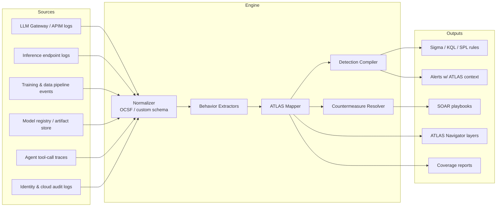

# ATLAS Behavior Map

**Behavior-to-MITRE ATLAS mapping engine for detecting and countering adversarial activity against AI/ML systems.**

[](LICENSE)
[](https://atlas.mitre.org)
[]()

---

## Overview

ATLAS Behavior Map converts raw telemetry from AI workloads (LLM gateways, inference endpoints, training pipelines, model registries, agent tool calls) into **observable behaviors**, maps each behavior to **MITRE ATLAS tactics and techniques**, and binds each technique to **detection logic** and **countermeasures** (ATLAS mitigations, plus automated response actions).

```
Telemetry ──► Behavior ──► ATLAS Technique ──► Detection ──► Countermeasure ──► Response
```

### Goals

- **Single source of truth** for AI threat behaviors, versioned as code.
- **Bidirectional traceability**: behavior ⇄ technique ⇄ detection ⇄ mitigation.
- **Coverage measurement** against the full ATLAS matrix (gaps, partial, full).
- **SIEM/SOAR portability**: emit Sigma, KQL (Microsoft Sentinel), SPL (Splunk), and ATT&CK Navigator layers from one definition.
- **ATT&CK bridging**: link ATLAS techniques to related ATT&CK enterprise techniques where the attack chain crosses into conventional infrastructure.

### Non-Goals

- Not a replacement for ATLAS. Technique and mitigation data is pulled from the official [`mitre-atlas/atlas-data`](https://github.com/mitre-atlas/atlas-data) release and pinned by version.
- Not a model firewall. It drives guardrails and controls; it does not implement them.

---

## Architecture



| Component | Responsibility |
|---|---|
| **Normalizer** | Maps source events into a common schema (OCSF-aligned, with AI-specific extensions: `prompt`, `completion`, `model_id`, `tool_call`, `token_usage`). |
| **Behavior Extractors** | Stateless and windowed detectors that emit behavior events (e.g., `BHV-PI-001: instruction override pattern in user input`). |
| **ATLAS Mapper** | Resolves behaviors to ATLAS tactic/technique/sub-technique IDs with a confidence score. |
| **Detection Compiler** | Compiles behavior definitions to target query languages. |
| **Countermeasure Resolver** | Binds ATLAS mitigations (`AML.M*`) and executable response actions to each technique. |

---

## Data Model

Each behavior is a YAML file under `behaviors/`. The mapping is the contract; everything else is generated.

```yaml
id: BHV-EXF-003
name: High-volume systematic inference queries consistent with model extraction
status: stable            # experimental | test | stable | deprecated
severity: high
confidence: medium

description: >
  A single principal issues a large number of structurally similar queries
  against an inference endpoint with low semantic variance and systematic
  input perturbation, consistent with surrogate-model training.

atlas:
  tactics:
    - AML.TA0010          # Exfiltration
  techniques:
    - id: AML.T0024.002   # Extract AI Model (via inference API)
      relationship: primary
    - id: AML.T0040       # AI Model Inference API Access
      relationship: precondition

attack_bridge:            # optional ATT&CK enterprise linkage
  - T1567                 # Exfiltration Over Web Service

telemetry:
  required:
    - source: inference_gateway
      fields: [timestamp, principal_id, model_id, session_id, input_embedding_norm]
  optional:
    - source: identity
      fields: [auth_method, ip, asn]

detection:
  logic: windowed_threshold
  window: 1h
  group_by: [principal_id, model_id]
  filters:
    principal_id: { not_in: [sp-batch-eval, sp-loadtest] }
  metrics:
    request_count: count
    input_embedding_variance: variance(input_embedding_norm)
    distinct_session_count: dcount(session_id)
  conditions:
    - request_count > 5000
    - input_embedding_variance < 0.15
    - distinct_session_count <= 2
  false_positives:
    - Authorized batch evaluation jobs (allowlist by service principal)
    - Load testing in non-prod

countermeasures:
  mitigations:
    - AML.M0004           # Restrict Number of AI Model Queries
    - AML.M0002           # Passive AI Output Obfuscation
    - AML.M0019           # Control Access to AI Models and Data in Production
  response:
    - action: rate_limit
      params: { principal: "{{principal_id}}", limit: 100/min, ttl: 24h }
    - action: degrade_output
      params: { mode: top1_label_only }
    - action: open_incident
      params: { queue: ai-sec, priority: P2 }
    - action: revoke_token            # requires_approval by registry default
      params: { principal: "{{principal_id}}" }

tests:
  - fixture: tests/fixtures/extraction_burst.jsonl
    expect: alert
  - fixture: tests/fixtures/benign_batch_eval.jsonl
    expect: no_alert

references:
  - https://atlas.mitre.org/techniques/AML.T0024
```

---

## Coverage Snapshot (seed behaviors)

| Behavior ID | Behavior | ATLAS Technique | Primary Mitigations | Default Response |
|---|---|---|---|---|
| BHV-PI-001 | Instruction-override pattern in direct user input | AML.T0051.000 LLM Prompt Injection: Direct | AML.M0020, AML.M0015 | Block, log, increment principal risk |
| BHV-PI-002 | Embedded instructions in retrieved content (RAG / web / email) | AML.T0051.001 LLM Prompt Injection: Indirect | AML.M0020, AML.M0015 | Quarantine source doc, strip, alert |
| BHV-JB-001 | Role-play / persona jailbreak sequences | AML.T0054 LLM Jailbreak | AML.M0020, AML.M0021 | Refuse, session risk escalation |
| BHV-LK-001 | System prompt disclosure in completion (canary + phrasing) | AML.T0056 Extract LLM System Prompt | AML.M0020 | Redact output, risk, incident |
| BHV-LK-002 | Sensitive data / PII in completion | AML.T0057 LLM Data Leakage | AML.M0020, AML.M0019 | DLP redact, incident |
| BHV-EXF-001 | Membership-inference probing (repeated candidates + scores) | AML.T0024.000 Infer Training Data Membership | AML.M0002, AML.M0004 | Label-only output, rate limit |
| BHV-EXF-002 | Model-inversion probing (single class + scores + perturbation) | AML.T0024.001 Invert AI Model | AML.M0002, AML.M0004 | Label-only output, rate limit |
| BHV-EXF-003 | Systematic extraction query volume | AML.T0024.002 Extract AI Model | AML.M0004, AML.M0002, AML.M0019 | Rate limit, degrade output, revoke |
| BHV-EV-001 | Adversarial perturbation in classifier inputs | AML.T0015 Evade AI Model / AML.T0043 Craft Adversarial Data | AML.M0015, AML.M0003 | Reject input, flag for review |
| BHV-PO-001 | Training data distribution shift (PSI) at ingest | AML.T0020 Poison Training Data | AML.M0007, AML.M0014 | Halt pipeline, incident |
| BHV-SC-001 | Unsigned / hash-mismatched model artifact loaded | AML.T0010.003 AI Supply Chain Compromise: Model | AML.M0014, AML.M0016 | Block deploy, alert |
| BHV-BD-001 | Backdoor trigger response in model scan (high ASR) | AML.T0018.000 Poison AI Model / AML.T0043.004 Insert Backdoor Trigger | AML.M0014, AML.M0008 | Block deploy, pull model, incident |
| BHV-AG-001 | Agent tool call outside declared scope | AML.T0053 AI Agent Tool Invocation | AML.M0019, AML.M0020 | Deny call, kill session |
| BHV-DOS-001 | Token-exhaustion / sponge inputs | AML.T0029 Denial of AI Service | AML.M0004 | Throttle, cap max tokens |
| BHV-CH-001 | Abnormal compute spend per principal | AML.T0034 Cost Harvesting | AML.M0004, AML.M0019 | Quota enforce, alert finance + SOC |

> IDs and names are validated against ATLAS 5.6.0 (pinned in `atlas/atlas-data.lock`). If ATLAS renames or restructures a technique, `abm validate` fails and lists the drift.
>
> All 15 are implemented with positive and benign near-miss fixtures. Stable: PI-001, PI-002, JB-001, LK-001, LK-002, EXF-003, SC-001. Test: EXF-001, EXF-002, EV-001, PO-001, BD-001, AG-001, DOS-001. Experimental: CH-001.
>
> EV-001, PO-001 and BD-001 consume scores from upstream controls (adversarial-input detector, drift monitor, backdoor scanner); they map and act on those signals rather than compute them. LK-001 requires a system-prompt canary (`ABM-CANARY-<8 hex>`) injected at the gateway.

---

## Repository Structure

```
.
├── behaviors/                 # Behavior definitions (source of truth)
│   ├── prompt-injection/
│   ├── exfiltration/
│   ├── supply-chain/
│   ├── jailbreak/
│   ├── leakage/
│   ├── evasion/
│   ├── poisoning/
│   ├── backdoor/
│   ├── agentic/
│   ├── availability/
│   └── cost/
├── atlas/
│   ├── catalog.yaml           # ATLAS tactics/techniques/mitigations (from atlas-sync)
│   ├── atlas-data.lock        # Pinned ATLAS release + sha256
│   └── NOTICE
├── src/abm/
│   ├── models.py              # Behavior schema (pydantic)
│   ├── catalog.py             # ATLAS catalog + atlas-data import
│   ├── loader.py / validator.py
│   ├── engine.py              # Reference detection engine (replay, fixtures)
│   ├── response.py            # Action registry, response planner, executors
│   ├── coverage.py            # Scoring, gaps, Navigator layer
│   ├── compilers/             # kql.py, sigma.py, spl.py
│   └── cli.py                 # `abm` CLI
├── schemas/behavior.schema.json   # Generated from the model (make schema)
├── scripts/gen_fixtures.py    # Deterministic fixture generator
├── tests/
│   ├── fixtures/              # Positive + benign near-miss JSONL telemetry
│   └── adversarial/           # Red-team replay corpora
├── docs/behavior-authoring.md
├── dist/                      # Generated rules (gitignored)
├── reports/                   # Generated coverage (gitignored)
├── .github/workflows/ci.yml
├── Makefile
└── pyproject.toml
```

---

## Quickstart

### Prerequisites

- Python 3.11+
- `make`
- Optional: Azure CLI (Sentinel deploy), Splunk SDK, `sigma-cli`

Runtime dependencies are only `pydantic` and `PyYAML`.

### Install

```bash
git clone https://github.com/<org>/atlas-behavior-map.git
cd atlas-behavior-map
make setup            # venv + editable install with dev deps
make atlas-sync       # refresh atlas/catalog.yaml from the official ATLAS release
```

### Validate and Build

```bash
make validate         # schema + ATLAS ID resolution + fixture replay
make test             # pytest
make build            # compile all targets into dist/
make coverage         # generate reports/coverage.{md,json} + Navigator layer
```

### CLI

```bash
abm validate behaviors/
abm compile --target kql --out dist/kql/
abm compile --target sigma --out dist/sigma/
abm map --behavior BHV-EXF-003 --format table
abm coverage --matrix atlas --layer reports/atlas-layer.json
abm replay --fixture tests/fixtures/extraction_burst.jsonl --respond --expect alert
abm test                                   # run every behavior's declared fixtures
abm gaps --tactic AML.TA0010
abm atlas-sync [--file ATLAS.yaml]         # online or offline catalog refresh
```

---

## Detection Output Examples

### KQL (Microsoft Sentinel)

```kql
// BHV-EXF-003 | AML.T0024.002 Extract AI Model
AIInferenceLogs
| where TimeGenerated > ago(1h)
| summarize RequestCount = count(),
            EmbeddingVariance = variance(InputEmbeddingNorm),
            Sessions = dcount(SessionId)
          by PrincipalId, ModelId, bin(TimeGenerated, 1h)
| where RequestCount > 5000 and EmbeddingVariance < 0.15 and Sessions <= 2
| join kind=leftanti (Watchlist_AIBatchAllowlist) on PrincipalId
| extend AtlasTechnique = "AML.T0024.002", AtlasTactic = "AML.TA0010",
         BehaviorId = "BHV-EXF-003"
```

### Sigma

```yaml
title: Indirect Prompt Injection in Retrieved Content
id: 6f1c2b8e-4c0a-4e7f-9a3b-2d5e8f1a0c11
status: test
logsource:
  category: llm_retrieval
  product: ai_gateway
detection:
  selection:
    retrieved_content|re:
      - '(?i)ignore (all|any|previous|prior) (instructions|directions)'
      - '(?i)you are now'
      - '(?i)system\s*:\s*'
  condition: selection
tags:
  - atlas.aml.t0051.001
  - atlas.aml.ta0005
level: high
```

> Regex signatures are a floor, not a ceiling. Production extractors combine signatures with classifier scores (`extractors/pi_classifier.py`) and provenance signals (untrusted source + instruction-bearing content + tool-call follow-on).

---

## Countermeasure Model

Countermeasures are layered and resolved per technique:

| Layer | Source | Example |
|---|---|---|
| **Preventive** | ATLAS mitigations (`AML.M*`) | AML.M0014 Verify AI Artifacts → signed model registry |
| **Detective** | Behavior detections | BHV-SC-001 hash mismatch at load |
| **Responsive** | Playbook actions | Block deploy, roll back to last signed version |
| **Recovery** | Runbooks in `docs/runbooks/` | Retrain from clean snapshot, rotate keys |

Response actions declare `requires_approval`, `blast_radius`, and `reversible` so SOAR can auto-execute low-risk actions and gate destructive ones.

```yaml
actions:
  rate_limit:      { requires_approval: false, reversible: true,  blast_radius: principal }
  degrade_output:  { requires_approval: false, reversible: true,  blast_radius: model }
  revoke_token:    { requires_approval: true,  reversible: true,  blast_radius: principal }
  pull_model:      { requires_approval: true,  reversible: true,  blast_radius: service }
  halt_pipeline:   { requires_approval: true,  reversible: true,  blast_radius: pipeline }
```

---

## Coverage Reporting

`make coverage` produces:

- **`reports/coverage.md`** — per-tactic coverage: techniques with stable detection, test-only, or none.
- **`reports/atlas-layer.json`** — importable into ATLAS Navigator, scored 0–3 (none / mitigation-only / detection / detection + automated response).
- **`reports/gaps.json`** — machine-readable gap list for backlog tooling.

Coverage scoring:

| Score | Meaning |
|---|---|
| 0 | No mapping |
| 1 | Mitigation documented, no detection |
| 2 | Detection in `test` or `stable` |
| 3 | Stable detection + validated automated response + adversarial replay passing |

---

## Testing

- **Unit**: extractor logic against labeled fixtures.
- **Adversarial replay**: red-team corpora in `tests/adversarial/` replayed through the full pipeline; every `stable` behavior requires at least one true-positive and one benign near-miss fixture.
- **Drift**: CI fails if a referenced ATLAS ID no longer resolves in the pinned release.
- **Query lint**: compiled KQL/SPL/Sigma validated with target-native linters.

```bash
make test
make replay
```

---

## Contributing

1. Create a behavior under the appropriate `behaviors/<category>/` directory.
2. Map to the most specific ATLAS sub-technique available; mark preconditions separately.
3. Include `tests` with at least one positive and one benign fixture.
4. Run `make validate test`.
5. Open a PR with the behavior ID, ATLAS IDs, and the telemetry source required.

Behavior ID prefixes: `PI` prompt injection · `JB` jailbreak · `LK` leakage · `EXF` exfiltration · `EV` evasion · `PO` poisoning · `SC` supply chain · `BD` backdoor · `AG` agentic · `DOS` denial of service · `CH` cost harvesting.

See [`docs/behavior-authoring.md`](docs/behavior-authoring.md).

---

## Roadmap

- [ ] Seed behavior set across all ATLAS tactics (15 behaviors in; remaining tactics: Reconnaissance, Resource Development, Discovery, Collection, Credential Access, Lateral Movement, C2)
- [ ] OCSF AI-event extension mapping
- [ ] Sentinel Content Hub packaging (analytics rules + workbooks + Logic Apps)
- [ ] Agentic AI telemetry: MCP / tool-call provenance graph
- [ ] Confidence calibration from production alert dispositions
- [ ] OWASP LLM Top 10 and NIST AI RMF cross-reference tags
- [ ] AWS (Bedrock / CloudTrail) and GCP (Vertex AI / Cloud Audit) source adapters

---

## References

- MITRE ATLAS — https://atlas.mitre.org
- ATLAS data repository — https://github.com/mitre-atlas/atlas-data
- MITRE ATT&CK — https://attack.mitre.org
- OWASP Top 10 for LLM Applications — https://genai.owasp.org
- NIST AI 100-2 Adversarial Machine Learning taxonomy — https://csrc.nist.gov

---

## License

MIT. ATLAS content is © The MITRE Corporation and used under its published terms; see [`atlas/NOTICE`](atlas/NOTICE).
